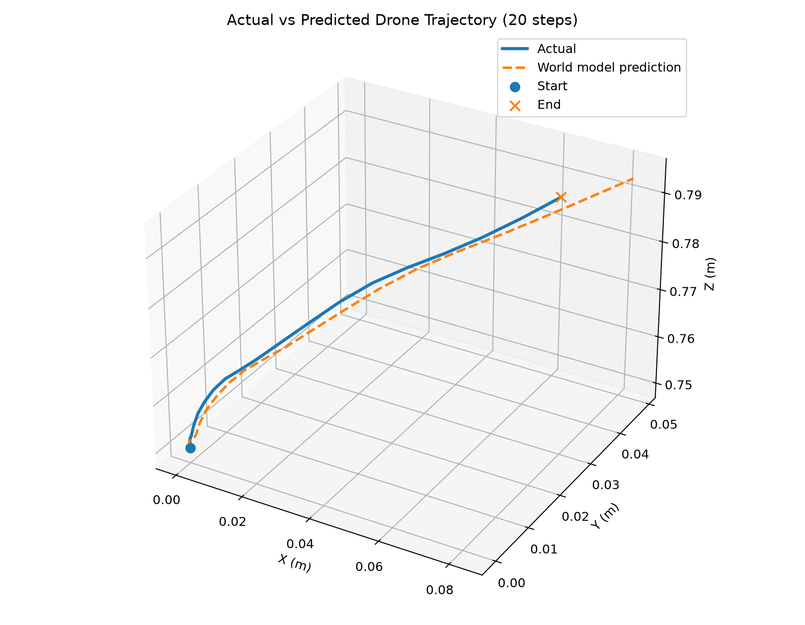
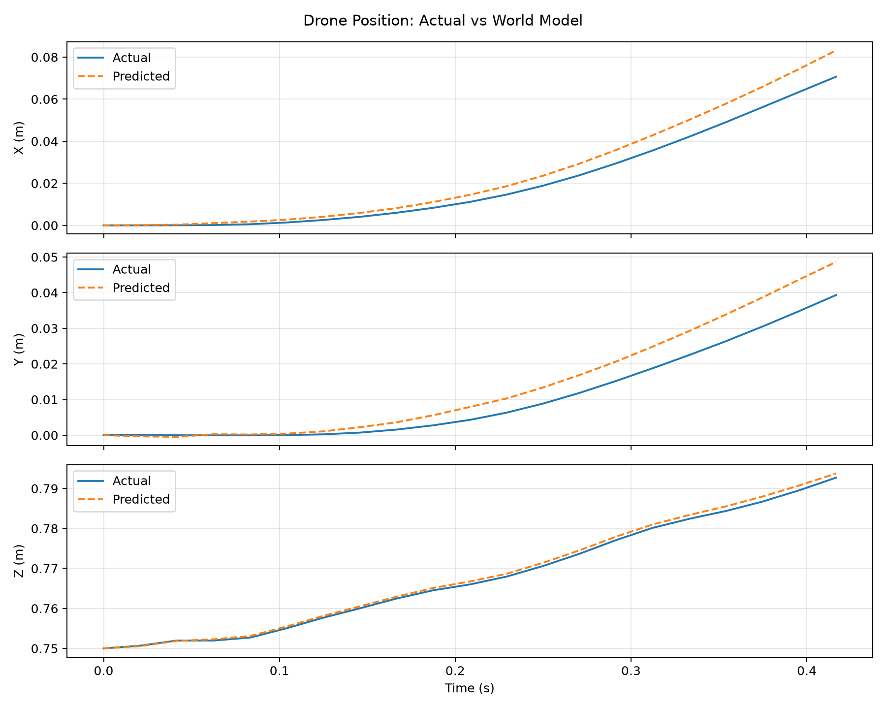
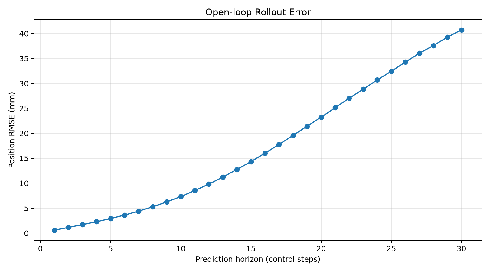
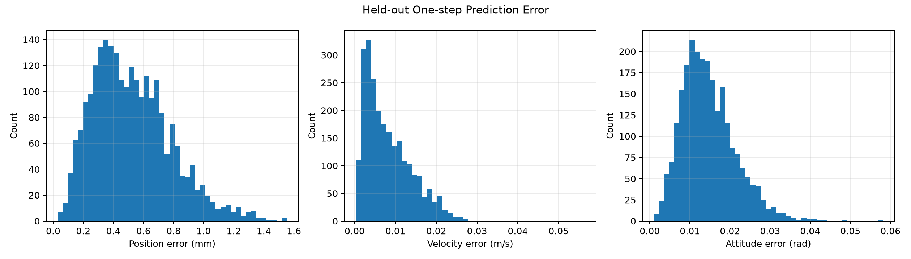

This reveals one important issue: your project directory currently isn't a Git repository. There is a README and all the development artifacts, but no .git directory and no configured Git remote. So the work is safe in the local folder, but it isn't yet connected to GitHub.

Also, the existing README is outdated: it describes Stage 1 as if the world model hasn't been trained. We've since completed training, evaluation, rollout visualization and the live PyBullet demonstration.

Let's fix the documentation first, then establish the GitHub repository without losing any existing work.
1. Replace the README with the actual development history
The new README will document the completed stages, measured results, visual evidence, reproducibility and next research direction. Run this from the project root:
cd ~/MARL/WorldModels/WorldPilot

cat > README.md <<'EOF'
# WorldPilot
### Learning Drone Dynamics Through Neural World Models

WorldPilot is a research project exploring learned dynamics models for autonomous
quadrotor systems. It uses PyBullet-based drone simulation, neural state-transition
models, and predictive trajectory evaluation.

The project is being developed incrementally, from a basic drone simulation and
dataset collection pipeline towards predictive navigation in challenging indoor
environments.

<p align="center">
  
</p>

## Development Progress

| Stage | Development | Status |
|---|---|---|
| 1 | CF2X drone simulation and obstacle navigation | Completed |
| 2 | Data collection and transition dataset | Completed |
| 3 | Neural dynamics model training | Completed |
| 4 | Prediction evaluation and autoregressive rollouts | Completed |
| 5 | Live PyBullet predictive demonstration | Completed |
| 6 | Indoor maze environment and autonomous navigation | In progress |
| 7 | Generalization across unseen environments | Planned |

---

## Stage 1 — Drone Simulation Environment

The initial environment uses a Crazyflie 2.x (CF2X) quadrotor simulated
through PyBullet and `gym-pybullet-drones`.

Implemented features:

- 3D quadrotor physics.
- Velocity-command interface.
- Randomized spherical obstacles.
- Goal-directed waypoint navigation.
- Potential-field obstacle avoidance.
- Collision and workspace-boundary checks.
- Headless simulation and interactive GUI demonstration.

The initial controller is a hand-designed waypoint controller, not a learned
navigation policy.

## Stage 2 — Dataset Collection

A transition dataset was collected using the waypoint navigation controller.

**Recorded experiment:**

| Metric | Result |
|---|---:|
| Episodes | 40 |
| Transitions | 11,465 |
| Successful goal-reaching episodes | 40 |
| Recorded obstacle collisions | 0 |
| Out-of-bounds transitions | 0 |
| State dimension | 28 |
| Action dimension | 3 |

Dataset: `datasets/worldpilot_stage2.npz`

The dataset contains:

| Array | Description |
|---|---|
| `state` | Current drone state |
| `action` | Commanded world-frame velocity |
| `next_state` | Next observed state |
| `collision` | Collision indicator |
| `goal_reached` | Goal-reaching indicator |
| `out_of_bounds` | Workspace-boundary indicator |
| `done` | Episode termination indicator |
| `episode_id` | Source episode |
| `timestep` | Step within episode |
| `trajectory_type` | Trajectory collection category |

### State representation

The original 28-dimensional state is:

| Indices | Description |
|---|---|
| `[0:3]` | Position (x, y, z) |
| `[3:6]` | Linear velocity |
| `[6:9]` | Roll, pitch and yaw |
| `[9:12]` | Goal-relative position |
| `[12:28]` | Four relative obstacle records |

Each obstacle record contains relative position and radius.

### Action representation

The action is a three-dimensional world-frame velocity command:

`[vx, vy, vz]` in metres per second.

## Stage 3 — Learning Drone Dynamics

A residual multilayer perceptron was trained to predict the next drone state.

The learned transition is:

\[
\hat{s}_{t+1} = s_t + f_\theta(s_t,a_t)
\]

where:

- \(s_t\) is the current state.
- \(a_t\) is the commanded velocity.
- \(f_\theta\) predicts the state change.
- \(\hat{s}_{t+1}\) is the predicted next state.

### Model architecture

| Layer | Dimensions |
|---|---|
| Input | 31 |
| Hidden layer 1 | 256 |
| Hidden layer 2 | 256 |
| Hidden layer 3 | 128 |
| Output | 28 |

ReLU activations are used between hidden layers.

Input and state-delta normalization are applied using training-set statistics.
The dataset is split by episode, rather than randomly splitting individual
transitions, to reduce temporal leakage between training and evaluation data.

**Checkpoint:** `checkpoints/worldpilot_mlp.pt`

## Stage 4 — Prediction Evaluation

The model was evaluated on eight held-out episodes containing 2,435 transitions.

### One-step prediction

| Metric | RMSE |
|---|---:|
| Position | 0.338 mm |
| Linear velocity | 0.00579 m/s |
| Attitude | 0.00933 rad |

### Autoregressive rollout evaluation

The model is repeatedly fed its own predicted state while using recorded
actions as inputs.

| Prediction horizon | Position RMSE |
|---|---:|
| 5 steps | 2.91 mm |
| 10 steps | 7.31 mm |
| 20 steps | 23.21 mm |
| 30 steps | 40.75 mm |

At 48 Hz, 20 steps correspond to approximately 0.42 seconds.

Prediction error increases with the rollout horizon, illustrating the
accumulation of model prediction errors over time.

**Important:** These results measure prediction on held-out episodes from
the original open-space environment distribution. They do not establish
generalization to unseen maze layouts or arbitrary flight conditions.

### Evaluation visualizations

**3D actual versus predicted trajectory**

<p align="center">
  
</p>

**Position tracking**

<p align="center">
  
</p>

**Autoregressive rollout error**

<p align="center">
  
</p>

**Prediction error distributions**

<p align="center">
  
</p>

## Stage 5 — Live Predictive Simulation

A live PyBullet demonstration integrates the trained dynamics model into
the simulation loop.

At each control step:

1. The waypoint controller generates a velocity command.
2. The learned model predicts the next drone state.
3. PyBullet advances the actual drone simulation.
4. Predicted and actual next positions are compared.
5. Prediction error and trajectory telemetry are recorded.

The learned model is used as a predictor; it does not control the drone.

### Demonstration video

[View the WorldPilot live simulation recording](outputs/worldpilot_live.mp4)

The recording includes the actual trajectory, model-predicted trajectory,
goal-distance telemetry and one-step position prediction error.

**Generated outputs:**

- `outputs/worldpilot_live.mp4`
- `outputs/worldpilot_live_telemetry.csv`

## Reproducing the Experiments

The project was developed using Python 3.12, PyTorch, PyBullet,
`gym-pybullet-drones`, NumPy and OpenCV.

Activate the project environment and install dependencies:

```bash
pip install -r requirements.txt
```

## 1. Test the simulation
python scripts/smoke_test.py


## 2. Collect transitions
python scripts/collect_data.py \
    --episodes 40 \
    --max-steps 576 \
    --output datasets/worldpilot_stage2.npz \
    --seed 107


## 3. Train the dynamics model
OMP_NUM_THREADS=1 \
MKL_NUM_THREADS=1 \
OPENBLAS_NUM_THREADS=1 \
python -u scripts/train_world_model.py \
    --data datasets/worldpilot_stage2.npz \
    --epochs 100 \
    --batch-size 256


## 4. Evaluate and visualize predictions
python scripts/visualize_world_model.py


## 5. Run the live demonstration
OMP_NUM_THREADS=1 \
MKL_NUM_THREADS=1 \
OPENBLAS_NUM_THREADS=1 \
python -u scripts/run_worldpilot_live.py


The live demonstration requires a working graphical display. Headless
dataset collection and model training do not require the PyBullet GUI.
Stage 6 — Indoor Maze Navigation
The next development phase moves from open-space obstacle avoidance to
structured indoor navigation.

Planned features:
- Indoor environments with enclosed walls and corridors.
- Narrow passages, corners and dead ends.
- Horizontal LiDAR/raycast sensing.
- A* global path planning.
- Local waypoint navigation.
- Collision-free flight evaluation.
- Bird's-eye-view (BEV) visualization of the drone and trajectories.
The first objective is reliable navigation through a fixed maze. Subsequent
experiments will introduce different maze configurations and held-out layouts.

A new dataset and model will be trained for this environment rather than
reusing the open-space checkpoint as evidence of indoor generalization.
Research Direction
The longer-term objective is to investigate learned predictive models for
autonomous drone navigation, including:
- Multi-step predictive accuracy.
- Model uncertainty and prediction drift.
- Generalization across environment configurations.
- Prediction-aware navigation.
- Integration of learned world models with safety mechanisms.
Project Structure
WorldPilot/
├── configs/
│   └── drone_config.yaml
├── scripts/
│   ├── collect_data.py
│   ├── run_demo.py
│   ├── run_worldpilot_live.py
│   ├── smoke_test.py
│   ├── train_world_model.py
│   ├── verify_dataset.py
│   └── visualize_world_model.py
├── worldpilot/
│   ├── config.py
│   ├── collector.py
│   └── environment.py
├── datasets/
├── checkpoints/
├── outputs/
├── requirements.txt
└── README.md


Acknowledgements
The quadrotor simulation is built using
gym-pybullet-drones
and PyBullet.

WorldPilot — From Drone Simulation to Learned Predictive Navigation.